<p align="center">
  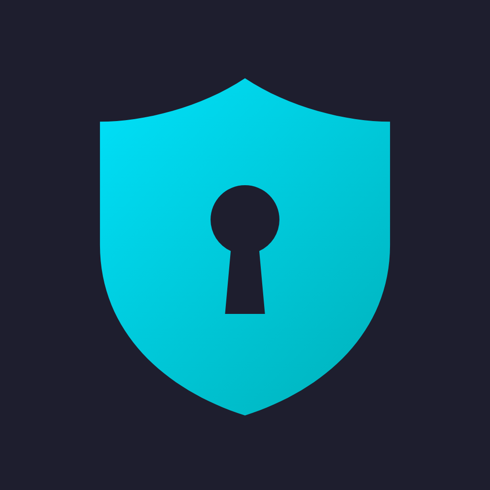
</p>

<h1 align="center">PassForge</h1>

<p align="center">
  <b>Forge Your Own Security.</b><br>
  A local-first, encrypted password manager for Android, built with Flutter and Material 3.<br>
  No backend server. Your passwords stay on your device, and an optional encrypted backup goes to <i>your own</i> Google Drive.
</p>

<p align="center">
  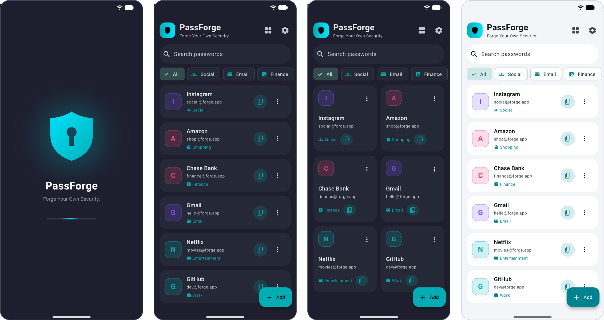
</p>

> **Status:** a personal project in active development. It has **not** had an independent security audit, so please don't treat it as your only copy of important passwords.

## Contents

- [Showcase](#showcase)
- [Features](#features)
- [Security model](#security-model)
- [Google Drive sync](#google-drive-sync)
- [Project structure](#project-structure)
- [Getting started](#getting-started)
- [Setting up Google Drive sync](#setting-up-google-drive-sync)
- [Testing](#testing)
- [Regenerating the icon and screenshots](#regenerating-the-icon-and-screenshots)
- [Known limitations](#known-limitations)
- [Tech stack](#tech-stack)

## Showcase

<table>
  <tr>
    <td align="center">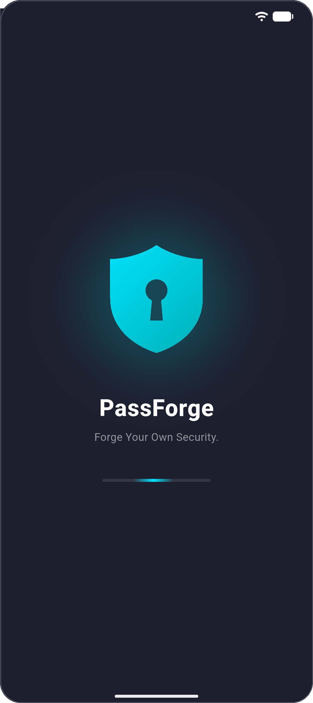<br><sub><b>Animated splash</b><br>shield draws itself, loading bar sweeps</sub></td>
    <td align="center">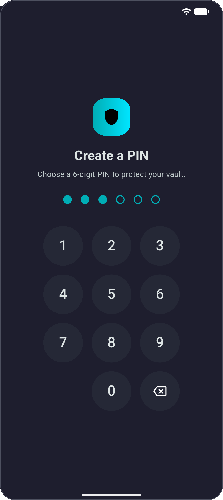<br><sub><b>PIN lock</b><br>6-digit pad with biometric unlock</sub></td>
    <td align="center">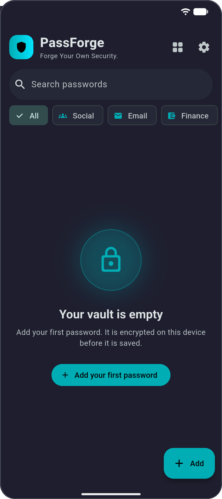<br><sub><b>Empty state</b><br>floating badge and a clear first action</sub></td>
    <td align="center">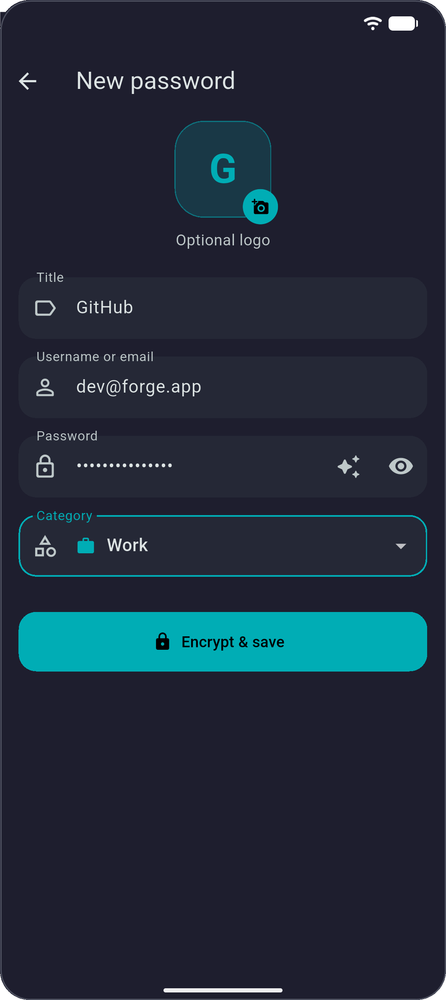<br><sub><b>Add / edit</b><br>masked password, category, optional logo</sub></td>
  </tr>
  <tr>
    <td align="center">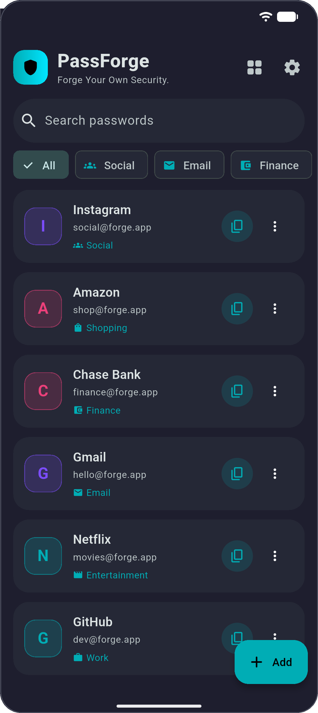<br><sub><b>Vault list</b><br>search, category chips, initials avatars</sub></td>
    <td align="center">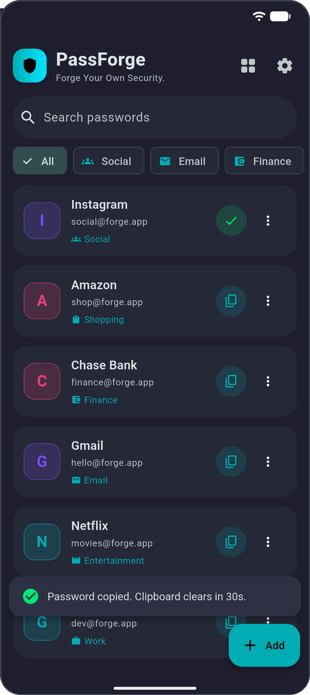<br><sub><b>Secure copy</b><br>clipboard clears itself after 30 s</sub></td>
    <td align="center">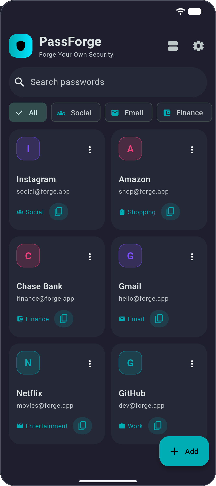<br><sub><b>Grid view</b><br>one tap to switch layouts</sub></td>
    <td align="center">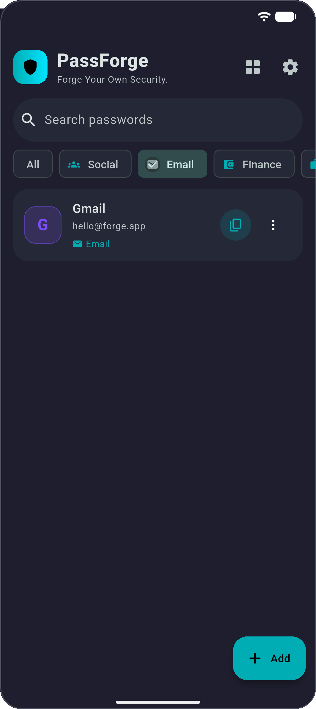<br><sub><b>Category filter</b><br>tap a chip to narrow the list</sub></td>
  </tr>
  <tr>
    <td align="center">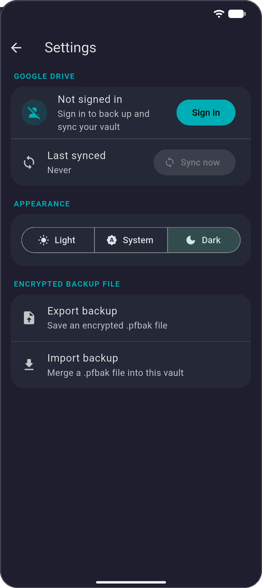<br><sub><b>Settings</b><br>Drive sync, theme, backup file</sub></td>
    <td align="center">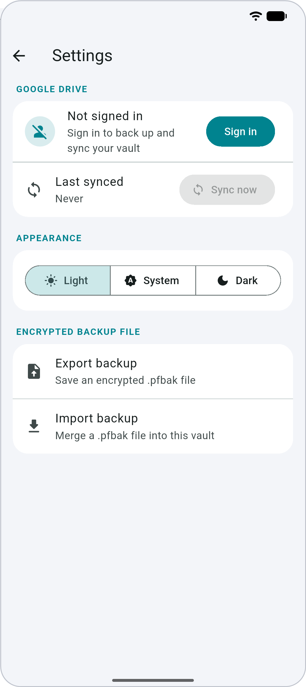<br><sub><b>Light theme</b><br>Light, Dark or System</sub></td>
    <td align="center">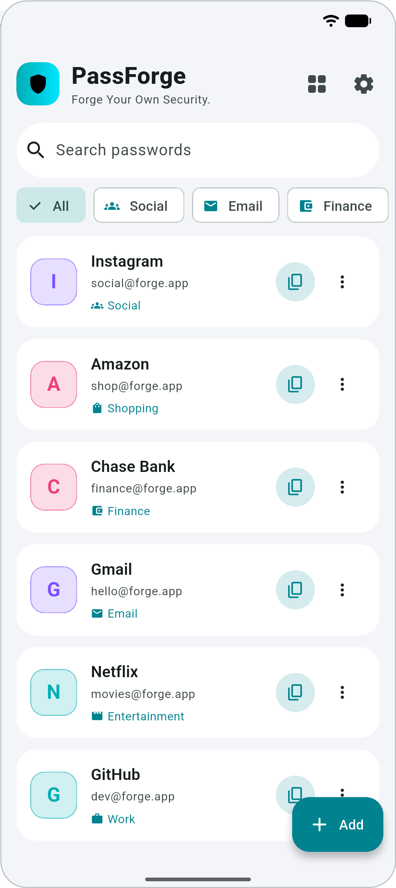<br><sub><b>Light home</b><br>same layout, tuned contrast</sub></td>
    <td></td>
  </tr>
</table>

<sub>Screenshots are from an Android emulator running a release build. All entries are fake sample data.</sub>

## Features

**Security**
- **Encrypted at rest.** Every password is encrypted with AES-256-GCM, and the database holding it is encrypted too. The keys live in the Android Keystore, never next to the data.
- **PIN and biometric lock.** A 6-digit PIN (salted PBKDF2) with fingerprint or face unlock. The vault locks the moment the app goes to the background.
- **Brute-force throttling.** Repeated wrong PINs trigger a growing lockout that survives restarts.
- **Secure copy.** Copying a password clears the clipboard after 30 seconds, but only if it still holds that password.
- **Strong password generator** built into the form.

**Vault**
- Add, edit and delete with an **undo** option, and a confirmation before anything is removed.
- **Search** by title or username, plus **category filters** (Social, Email, Finance, Work, Shopping, Entertainment, Other).
- **List and grid** layouts, with colored initial avatars or your own local logo.

**Backup and sync**
- **Google Drive backup** to a hidden app folder (`appDataFolder`) that never shows up in your normal Drive files.
- **Per-item merge** with deletion markers, so two devices can edit the same vault without resurrecting deleted items.
- **Encrypted backup file** (`.pfbak`): export and import locally, protected by your own passphrase.

**Polish**
- Material 3 with **Light, Dark and System** themes (your choice is remembered).
- Animated splash, staggered list animations, a copy button that morphs into a check, and friendly empty states. Animations are skipped when the OS "reduce motion" setting is on.

## Security model

| Layer | What it protects | How |
|---|---|---|
| Field | Each password | AES-256-GCM, fresh random IV per save, key stored in the device keystore |
| Database | The whole vault | Hive box encrypted with AES-256 (`HiveAesCipher`), with a *separate* random key in the keystore |
| PIN | App access | PBKDF2-HMAC-SHA256, 100,000 iterations, random salt. Only the hash is stored |
| Backup (Drive and file) | A portable copy | AES-256-GCM, key derived from **your backup passphrase** with PBKDF2 (200,000 iterations) |

Keystore keys can't move between phones, so backups use a key derived from a passphrase you choose. That is what lets a new device restore them. **If you forget the backup passphrase, the backup cannot be recovered.**

## Google Drive sync

1. **Upload:** the vault is decrypted in memory, turned into a snapshot, encrypted with your passphrase, and written to `passforge_vault.enc` in the hidden `appDataFolder`.
2. **New device or reinstall:** sign in with Google, enter your passphrase, and the first sync downloads, decrypts and merges the cloud copy.
3. **Conflicts:** merged per item by `updatedAt`. The newer edit wins, a newer delete beats an older edit, and a newer edit revives an older delete. Deletion markers expire after 90 days.

Sync is manual (the **Sync now** button in Settings) and uses each device's clock, so a badly wrong clock can win unfairly.

## Project structure

Feature-first, with a domain / data / presentation split inside the vault feature.

```
lib/
├─ main.dart                    # composition root: wires dependencies
├─ core/
│  ├─ security/                 # keystore wrapper, AES service, PBKDF2, secure clipboard
│  ├─ theme/                    # Material 3 light/dark themes, theme controller
│  └─ widgets/                  # logo painter, shared animation widgets
└─ features/
   ├─ splash/                   # animated splash + gate that waits for startup
   ├─ lock/                     # PIN + biometric lock, lifecycle lock gate
   ├─ vault/                    # model, Hive repository, home + form screens
   ├─ sync/                     # Drive service, merge logic, backup crypto, file backup
   └─ settings/                 # account, sync, theme, backup file
tool/                           # icon generator (run manually)
docs/screenshots/               # images used in this README
```

## Getting started

**Requirements:** Flutter 3.47 or newer (Dart 3.13+) and an Android device or emulator **with Google Play** (needed for Google sign-in).

```bash
git clone https://github.com/deXT-Sadman/passforge.git
cd passforge
flutter pub get
flutter run
```

Everything works out of the box except Google Drive sync, which needs your own Google Cloud credentials (below).

## Setting up Google Drive sync

Skip this if you don't need cloud backup. The app works fully offline without it.

1. In [Google Cloud Console](https://console.cloud.google.com), create a project and enable the **Google Drive API**.
2. Configure the **OAuth consent screen**. Under *Data Access*, add the scope `https://www.googleapis.com/auth/drive.appdata`. While the app is in *Testing*, add your Google account under *Audience → Test users*.
3. Create an **Android** OAuth client with package name `com.example.passforge` and your signing SHA-1. For a debug build:
   ```bash
   cd android
   ./gradlew signingReport
   ```
4. Create a **Web application** OAuth client and put its client ID in `kGoogleServerClientId` in [`lib/features/sync/drive_service.dart`](lib/features/sync/drive_service.dart). Android sign-in needs this value. It is an identifier, not a secret.
5. New clients can take from a few minutes to a few hours to start working.

Never commit a `client_secret*.json`, `google-services.json` or keystore. They are listed in `.gitignore`, and this app doesn't use a client secret.

## Testing

```bash
flutter analyze
flutter test
```

The tests cover the item model, the sync merge rules, backup encryption (including wrong-passphrase rejection), the empty states, and a regression test for the splash/lock layout. Drive sign-in, biometrics and file picking need a real device and aren't covered by automated tests.

## Regenerating the icon and screenshots

The app icon, native splash image and in-app splash all draw the same logo from [`forge_logo.dart`](lib/core/widgets/forge_logo.dart).

```bash
flutter test tool/generate_icons_test.dart   # writes assets/icon/*.png
dart run flutter_launcher_icons              # Android launcher icons
dart run flutter_native_splash:create        # native splash
```

The screenshots in `docs/screenshots/` were captured from an emulator with Android's demo mode enabled for a clean status bar.

## Platform notes

- **Android** is the primary target. `minSdk` is 23, and `MainActivity` extends `FlutterFragmentActivity` as `local_auth` requires.
- **iOS** hasn't been set up or tested. If you add it, put `NSFaceIDUsageDescription` in `ios/Runner/Info.plist`.
- **Windows and desktop:** `google_sign_in` doesn't support Windows, so Drive sync is unavailable there.
- Before publishing, replace the debug signing config with a release keystore and change the `com.example.passforge` application ID.

## Known limitations

- Android screenshots and the app-switcher preview aren't blocked (`FLAG_SECURE` isn't set).
- A forgotten PIN can't be reset inside the app. Clearing the app's data is the only way back in, and that deletes the local vault.
- Passwords are decrypted only when you copy, edit, sync or export them. Exporting or syncing briefly holds the whole vault in plain text in memory, and there is no extra unlock prompt before an export.
- Sync is manual and last-write-wins. Two devices syncing at exactly the same moment can miss each other's changes until the next sync.
- Custom logos are stored on the device only and aren't synced.
- No license file has been added yet.

## Tech stack

Flutter · Material 3 · `hive_ce` · `flutter_secure_storage` · `encrypt` + `pointycastle` · `local_auth` · `google_sign_in` + `googleapis` · `file_picker` · `image_picker` · `flutter_launcher_icons` and `flutter_native_splash` (dev)
